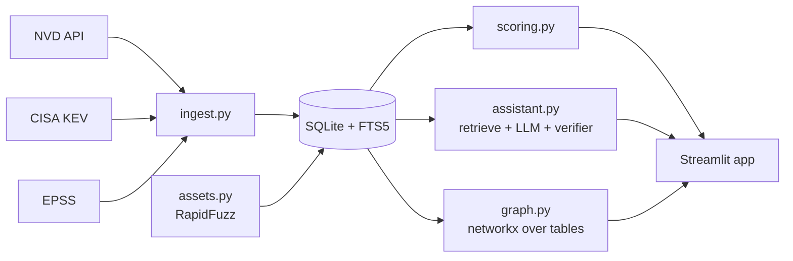

# PatchPilot

Exploit-aware patch prioritisation with an **evidence-only assistant**. Built in 8 hours by a team of 4.

We deliberately do two things well:
1. **Ranking you can defend**: `Risk = 0.35*CVSS/10 + 0.30*EPSS + 0.20*KEV + 0.15*Asset`, every score explained, and a backtest against CVSS-only.
2. **An assistant that cannot invent patches**: answers only from retrieved evidence, a deterministic verifier checks every citation, and it refuses when evidence is missing.

> Status: active build. The real-data ingestion pipeline and snapshot, scoring, fixture, new-KEV detector, verifier, and Streamlit shell are implemented.

## Quickstart
```
pip install -r requirements.txt
python -m patchpilot.ingest fixture
```

The fixture command writes to `data/fixture.db`, so it never overwrites the real snapshot. To launch the fixture in PowerShell:
```
$env:DB_PATH = "data/fixture.db"
streamlit run app.py
```

Use the committed real snapshot by default, refresh it with `python -m patchpilot.ingest snapshot`, and run:
```
streamlit run app.py
python -m pytest -q
```
The development fixture is **synthetic** (`CVE-2099-*`). To keep the committed snapshot below 50 MB, its default NVD window is 2025-10-01 through 2025-12-31; `python -m patchpilot.ingest snapshot --start 2024-01-01` requests the full issue window. The snapshot also includes current CISA KEV entries, current EPSS scores, and an FTS index.

For the real-data demo, load `sample_assets.csv` from the Assets tab before using the KEV demo button. It includes Valkey, so the real CVE-2025-49844 scenario rises to the top of the queue.

Download and load the archived EPSS cutoffs used by the backtest with:
```
python -m patchpilot.ingest epss-history 2025-01-01 2025-07-01
```

## Architecture

The "knowledge graph" is a graph data model over SQLite tables (CVE-CWE, CVE-Product, CVE-Fix, Product-Asset), queried with SQL and visualised with networkx/pyvis. It is not Neo4j.

## Team workflow
See [CONTRIBUTING.md](CONTRIBUTING.md), [config/project.json](config/project.json) (the contract)

## Results
_Backtest and eval numbers go here (P2-4, P3-4, P4-5)._
