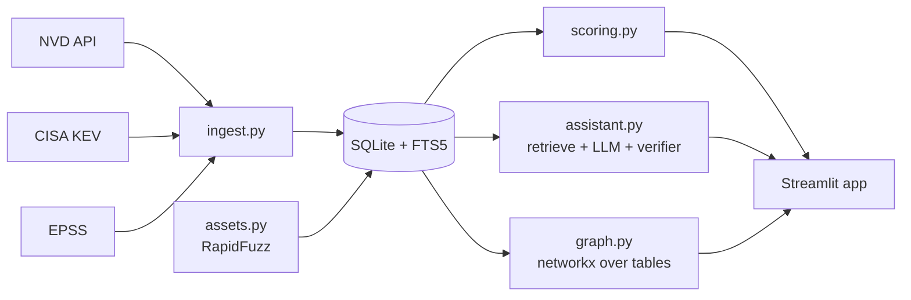

# PatchPilot

Exploit-aware patch prioritisation with an **evidence-only assistant**. Built in 8 hours by a team of 4.

We deliberately do two things well:
1. **Ranking you can defend**: `Risk = 0.35*CVSS/10 + 0.30*EPSS + 0.20*KEV + 0.15*Asset`, every score explained, and a backtest against CVSS-only.
2. **An assistant that cannot invent patches**: answers only from retrieved evidence, a deterministic verifier checks every citation, and it refuses when evidence is missing.

> Status: **skeleton**. Scoring, fixture, new-KEV detector, verifier and the Streamlit shell work. Everything else is a stub with an owner and an issue.

## Quickstart
```
pip install -r requirements.txt
python -m patchpilot.ingest fixture
streamlit run app.py
python -m pytest -q
```
The fixture is **synthetic** (`CVE-2099-*`). Real data arrives with `data/patchpilot.db` (issue P1-4).

## Architecture

The "knowledge graph" is a graph data model over SQLite tables (CVE-CWE, CVE-Product, CVE-Fix, Product-Asset), queried with SQL and visualised with networkx/pyvis. It is not Neo4j.

## Team workflow
See [CONTRIBUTING.md](CONTRIBUTING.md), [config/project.json](config/project.json) (the contract)

## Results
_Backtest and eval numbers go here (P2-4, P3-4, P4-5)._
